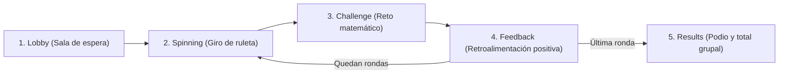

# Flujo Pedagógico y Lógico del Juego — MateRueda

Este documento describe el ciclo completo de una sesión de **MateRueda**, tanto en modalidad **📱 1 dispositivo** (turnos rotativos en aula) como en modalidad **🌐 Varios dispositivos** (sincronizada en tiempo real).

---

## Fases de la Partida (`LocalPhase`)

### 1. Configuración y Sala de Espera (`lobby`)
- La persona docente elige la modalidad (**1 dispositivo** o **Varios dispositivos**), el número de rondas (`5`, `8`, `10` o `12`), el nivel numérico (**Básico hasta 10** o **Ampliado hasta 20**) y las categorías activas (**RF01, RF10**).
- En **1 dispositivo**, la docente define cuántas mesas participarán (2 a 4).
- En **Varios dispositivos**, se genera un código de 6 caracteres (ej. `K7M4P9`) y cada mesa se une desde su tableta/teléfono eligiendo su nombre y color de equipo.

### 2. Ruleta de Categorías (`spinning`)
- La pantalla presenta una ruleta colorida dividida en las **5 categorías matemáticas** activas (**RF02**).
- Al girar:
  - En modo online, el anfitrión dispara `spinNonce` y selecciona la categoría destino para que **todos los dispositivos giren simultáneamente** con animación desacelerada y sonido suave de giro (`25 %` de volumen).
  - Al detenerse la aguja, `TtsService` anuncia en voz alta la categoría obtenida y avanza al reto.

### 3. Reto Matemático (`challenge`)
`MathChallengeGenerator` construye un reto visual con una consigna breve de una línea leída automáticamente en voz alta (**RF03, RNF01, RNF02**):

1. **Conteo (OA1)**: Colección de 1 a 10 (o hasta 20) objetos ilustrados; la mesa elige el número correspondiente.
2. **Suma (OA2)**: Dos grupos visuales de objetos unidos por el signo `+`; la mesa toca el resultado correcto.
3. **Resta (OA3)**: Colección visual donde los elementos restados aparecen marcados suavemente; la mesa selecciona cuántos quedan.
4. **Comparación (OA4)**: Dos grupos lado a lado (`◀` izquierda, `=` igual cantidad, `▶` derecha).
5. **Figuras geométricas con objetos cotidianos del hogar (OA5)**: Alterna automáticamente dos variantes pedagógicas:
   - **Variante A (Objeto → Figura)**: Muestra un objeto cotidiano (*el reloj de pared*, *la ventana*, *el pedazo de pizza* o *el celular*) y pregunta qué forma geométrica tiene.
   - **Variante B (Figura → Objeto)**: Muestra una figura geométrica (*círculo*, *cuadrado*, *triángulo* o *rectángulo*) y pregunta cuál objeto cotidiano tiene esa forma.

- **Control de turnos**: En modo multidispositivo, únicamente la mesa que tiene el turno activo tiene habilitados los botones de opción (**RF04**), mientras el resto del aula observa el mismo reto en tiempo real para apoyar colaborativamente (**OA6**).

### 4. Retroalimentación Positiva (`feedback`)
- Validación inmediata (**RF05**) y acompañamiento afectivo (**RF06, RF07**):
  - **Si acierta**: Mensaje entusiasta (*"¡Muy bien, Mesa Sol!"*), narración por voz, sonido alegre y suma de **+1 estrella** al marcador del equipo (**RF08**).
  - **Si no acierta**: Mensaje empático **nunca punitivo** (*"¡Casi! Buen intento"*), sonido neutro suave y visualización clara de la respuesta correcta para reforzar el aprendizaje.
- La persona docente (o la mesa en modo 1 dispositivo) pulsa **Siguiente ronda** para continuar (**RF10**).

### 5. Resultados y Celebración Grupal (`results`)
- Al completar todas las rondas configuradas (**RF09**):
  - Se muestra el **total animado de estrellas logradas por toda el aula** para reforzar el logro colectivo (**OA6**).
  - Se presenta el podio de mesas con medallas e insignias positivas para todos los equipos participantes.
  - En partidas multidispositivo se muestra el indicador de cumplimiento **RNF05** con el porcentaje de eventos sincronizados en $\le 3\text{ s}$ y la latencia promedio en milisegundos.
